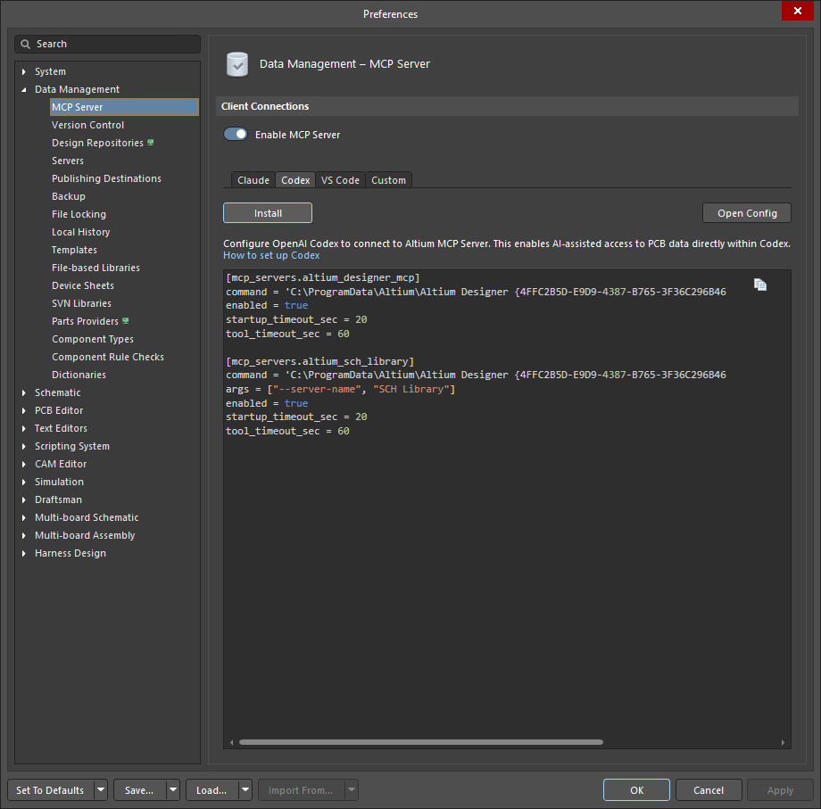
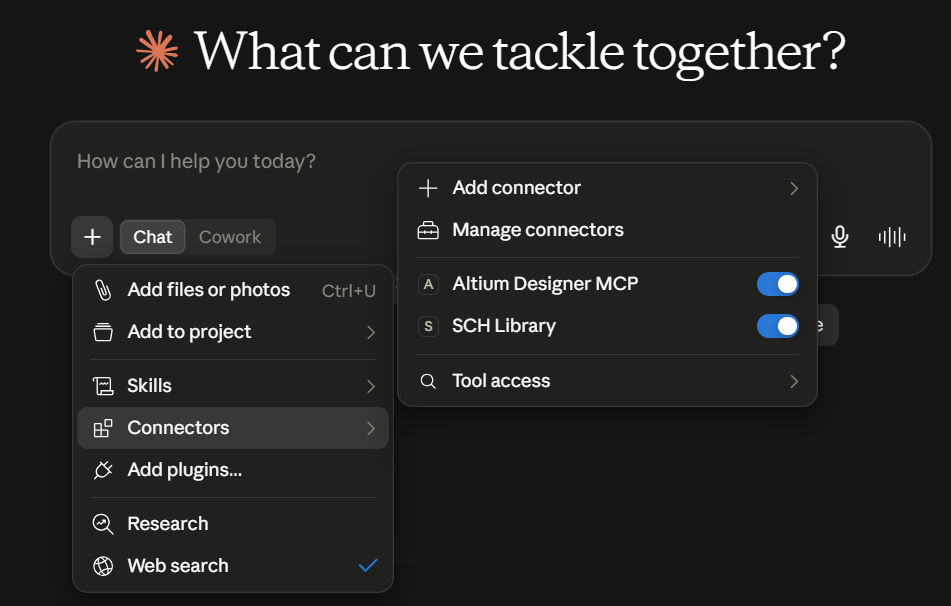

# Getting started

## What you need before you start

| Requirement | Notes |
| --- | --- |
| **Altium Designer 26.5 or later** | Download from <https://www.altium.com/products/downloads>. |
| **MCP add-on license** | The *Altium Designer MCP* feature, in addition to your normal Altium Designer license. Check under **License Management**. |
| **MCP Server extension** | Installed from inside Altium Designer ([Install the MCP Server extension in Altium Designer](#install-the-mcp-server-extension-in-altium-designer)). |
| **An Altium 365 workspace** | Needed for comments, project history and revisions, and part and library lookups — signed in, and with the project managed there for the first three. Plain schematic questions do not require it. |
| **An AI client on the same PC** | Claude Desktop is the recommended starting point (<https://claude.ai>). OpenAI Codex and VS Code are also supported out of the box. |

New capabilities arrive with each release, so a recent build offers more than an older one.
If this documentation describes something you cannot find, update the extension
([Updating](#updating)).

> **Running several copies of Altium Designer at once is supported** — a conversation binds
> to one of them and can be told to switch. See
> [If you run more than one copy of Altium Designer](./multiple-instances.md).

## Install the AI client

Install **Claude Desktop** from <https://claude.ai> and sign in.

Notes for first-time users:

- Inside Claude you can choose between models (for example *Opus* and *Sonnet*). Opus is
  the stronger reasoner and is the better choice for design review; Sonnet is faster and
  cheaper. You can switch models per conversation.
- If your IT policy blocks the normal installer, the MSIX package can be used instead:
  <https://api.anthropic.com/api/desktop/win32/x64/msix/latest/redirect>
- Other AI clients work too, but MCP support differs between them. The instructions below
  are written for Claude; the same buttons exist for Codex and VS Code.

## Install the MCP Server extension in Altium Designer

1. Start Altium Designer.
2. Go to **Extensions and Updates**.
3. Find **MCP Server** in the list of extensions and install it.
4. **Restart Altium Designer.**

## Connect Altium Designer to your AI client

1. In Altium Designer, open **Preferences → Data Management → MCP Server**.
2. Make sure **Enable MCP Server** is ticked.
3. In the **Client Connections** area, pick the tab for your client — **Claude**,
   **Codex**, **VS Code**, or **Custom**.
4. Click **Install**.
   This writes the connection settings into your AI client's configuration file for you.
   The button changes to **Uninstall** once it is done.
5. **Fully close and reopen your AI client**, so it re-reads its configuration.

*The MCP Server preferences page: the Enable MCP Server toggle, the per-client tabs, and the
configuration that Install writes for you.*

> **Closing Claude Desktop really means closing it.** Clicking the ✕ only hides the
> window. Right-click the Claude icon in the Windows system tray (bottom-right, next to
> the clock) and choose **Quit**, then start it again from the desktop icon.

> **If you had an earlier version registered**, click **Uninstall** first, then
> **Install** again. The same applies after a Claude Desktop update — updates sometimes
> reset the configuration and the Altium connector disappears.

**If the Install button does not work** (for example on a locked-down machine), use the
configuration block shown on the same page: copy it with the icon at its top-right corner
and paste it into your client's configuration file yourself. The **Open Config** button
opens that file's location, and its tooltip shows the exact path being written. For VS Code,
use **Ctrl+Shift+P → MCP: Add Server → HTTP**, then paste the configuration shown on the
**VS Code** tab.

The page tells you when it cannot do the job itself: pressing **Install** puts a warning on
the client's tab if its configuration file cannot be read or written, or if the bridge
executable is missing from the installation — and, for Claude, if the file is not valid
JSON. For Claude, **Install** writes every configuration file it finds, so a Microsoft Store
install is covered as well as a normal one.

> **Experimental Tools.** If your account has beta features enabled, the preferences page
> also offers an **Experimental Tools** switch — *"Exposes in-development MCP tools"*.
> Leave it off unless you want the schematic editing tools
> ([Schematic editing (experimental)](./tools/editing.md)); turning it on or off restarts the
> MCP servers, so reconnect your AI client afterwards.

## Check that it works

1. In Altium Designer, open a project (a project from an Altium 365 workspace is the best
   first test, because it enables the commenting features too).
2. Start your AI client.
3. Confirm that the Altium tools are listed and enabled. In Claude Desktop, click **+** in
   the message box and choose **Connectors** — you should see two, both switched on:
   - **Altium Designer MCP** — schematic data, ERC, history and revisions, comments
   - **SCH Library** — symbol creation and pinout tools
4. Ask a simple question, for example:

   > *"List all nets in my active project using the Altium MCP."*

5. Approve the tool call when Claude asks for permission.

*Both Altium connectors switched on in Claude Desktop, under **+ → Connectors**.*

If you get a sensible list of nets back, you are set up. Go straight to
[Try it now](./sample-prompts.md).

## Updating

1. When a new version of the extension is released it appears in
   **Extensions and Updates → Updates**. Select it and click **Update**.
2. Fully close your AI client (system tray → Quit).
3. Restart Altium Designer.
4. Start the AI client again.
