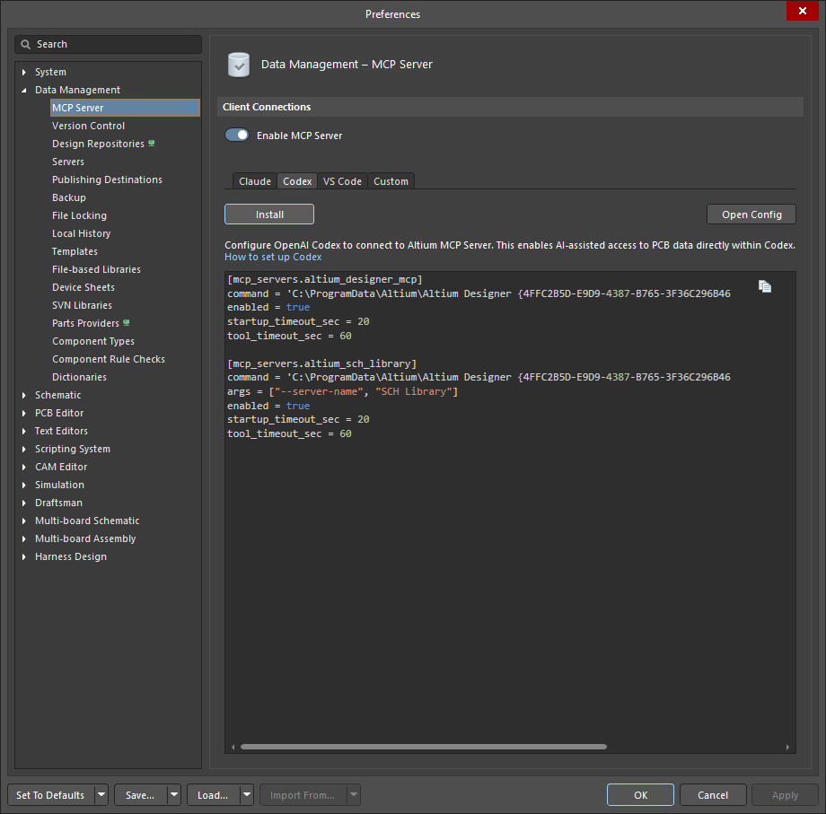
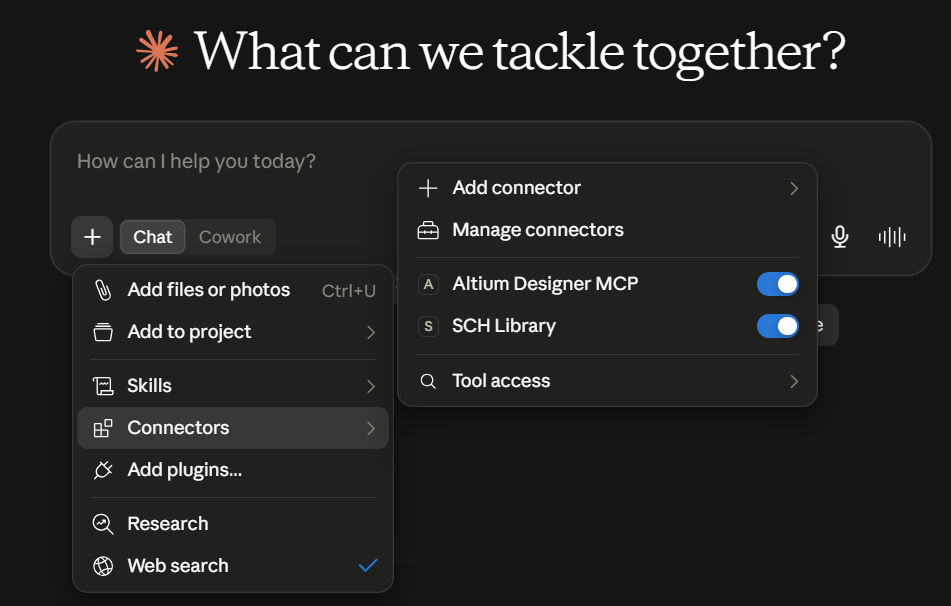

# Altium Designer MCP Server Quick Start Guide

The **Altium Designer MCP Server** is an extension for Altium Designer that lets an AI
assistant — such as Claude — read and act on the design you currently have open. This guide
takes you from installation to your first questions on a real board.

## Prerequisites

| Requirement | Notes |
| --- | --- |
| **Altium Designer 26.5 or later** | Download from <https://www.altium.com/products/downloads>. |
| **MCP add-on license** | The *Altium Designer MCP* feature, in addition to your normal Altium Designer license. Check under **License Management**. |
| **MCP Server extension** | Installed from inside Altium Designer (Step 2). |
| **An Altium 365 workspace** | Needed for comments, project history and revisions, and part and library lookups — signed in, and with the project managed there for the first three. Plain schematic questions do not require it. |
| **An AI client on the same PC** | Claude Desktop is the recommended starting point (<https://claude.ai>). OpenAI Codex and VS Code are also supported out of the box. |

> **Running several copies of Altium Designer at once is supported** — a conversation binds
> to one of them and can be told to switch. See
> [If you run more than one copy of Altium Designer](https://docs.developer.altium.com/ad-mcp-docs/multiple-instances/).

## Step 1: Install the AI client

Install **Claude Desktop** from <https://claude.ai> and sign in.

Notes for first-time users:

- Inside Claude you can choose between models (for example *Opus* and *Sonnet*). Opus is
  the stronger reasoner and is the better choice for design review; Sonnet is faster and
  cheaper. You can switch models per conversation.
- If your IT policy blocks the normal installer, the MSIX package can be used instead:
  <https://api.anthropic.com/api/desktop/win32/x64/msix/latest/redirect>
- Other AI clients work too, but MCP support differs between them. The instructions below
  are written for Claude; the same buttons exist for Codex and VS Code.

## Step 2: Install the MCP Server extension in Altium Designer

1. Start Altium Designer.
2. Go to **Extensions and Updates**.
3. Find **MCP Server** in the list of extensions and install it.
4. **Restart Altium Designer.**

## Step 3: Connect Altium Designer to your AI client

1. In Altium Designer, open **Preferences → Data Management → MCP Server**.
2. Make sure **Enable MCP Server** is ticked.
3. In the **Client Connections** area, pick the tab for your client — **Claude**,
   **Codex**, **VS Code**, or **Custom**.
4. Click **Install**.
   This writes the connection settings into your AI client's configuration file for you.
   The button changes to **Uninstall** once it is done.
5. **Fully close and reopen your AI client**, so it re-reads its configuration.

*The MCP Server preferences page: the Enable MCP Server toggle, the per-client tabs, and the
configuration that Install writes for you.*

> **Closing Claude Desktop really means closing it.** Clicking the ✕ only hides the
> window. Right-click the Claude icon in the Windows system tray (bottom-right, next to
> the clock) and choose **Quit**, then start it again from the desktop icon.

> **If you had an earlier version registered**, click **Uninstall** first, then
> **Install** again. The same applies after a Claude Desktop update — updates sometimes
> reset the configuration and the Altium connector disappears.

**If the Install button does not work** (for example on a locked-down machine), use the
configuration block shown on the same page: copy it with the icon at its top-right corner
and paste it into your client's configuration file yourself. The **Open Config** button
opens that file's location, and its tooltip shows the exact path being written. For VS Code,
use **Ctrl+Shift+P → MCP: Add Server → HTTP**, then paste the configuration shown on the
**VS Code** tab.

## Step 4: Check that it works

1. In Altium Designer, open a project (a project from an Altium 365 workspace is the best
   first test, because it enables the commenting features too).
2. Start your AI client.
3. Confirm that the Altium tools are listed and enabled. In Claude Desktop, click **+** in
   the message box and choose **Connectors** — you should see two, both switched on:
   - **Altium Designer MCP** — schematic data, ERC, history and revisions, comments
   - **SCH Library** — symbol creation and pinout tools
4. Ask a simple question, for example:

   > *"List all nets in my active project using the Altium MCP."*

5. Approve the tool call when Claude asks for permission.

*Both Altium connectors switched on in Claude Desktop, under **+ → Connectors**.*

If you get a sensible list of nets back, you are set up. Go straight to Step 5. If not, see
[Troubleshooting](https://docs.developer.altium.com/ad-mcp-docs/troubleshooting/).

## Step 5: Try it now

Four of the twelve prompts in [Try it now](https://docs.developer.altium.com/ad-mcp-docs/sample-prompts/).
Each is chosen to show you something you could **not** get by pasting a netlist or a
screenshot into a chat window, so you can judge the value quickly, on your own design.
Copy them as they are. You do not need to know any tool names.

These use the **Altium Designer MCP** connector. Open a project first.

**1. Get your bearings.**

> *"Using the Altium MCP, give me a one-page overview of this project: sheets, component
> counts, the power rails, and the ten nets with the most pins."*

Proves the assistant is really reading your design, and gives you a baseline to check
against what you know.

**2. Trace a signal, then see it on the sheet.**

> *"What is connected to the RESET pin of U1? List every pin on that net with its
> component, value and direction — then highlight that net on the schematic."*

Cross-sheet connectivity resolved for you, and the answer lands in Altium Designer: the net
is selected and zoomed to on the sheet in front of you.

**3. Run a real review pass.**

> *"Run ERC, summarise the violations by severity and by sheet, then show me which checks
> are switched off in the configuration."*

The last clause is the one that earns its keep — a clean ERC result means little until you
know which rules were disabled.

This one uses the **SCH Library** connector. Create or open a `.SchLib` (or a workspace
component in the Component Editor) and click into it so it is the active document.

**4. Build a symbol from a part number.**

> *"Create a symbol for STM32F103C8T6 in the library I have open. Show me the full pinout
> table for review before you build anything."*

The part is looked up for you. The review table is the gate — read it before saying yes.

## Next steps

- [Try it now](https://docs.developer.altium.com/ad-mcp-docs/sample-prompts/) — the other eight prompts
- [Working with the LLM](https://docs.developer.altium.com/ad-mcp-docs/working-with-the-llm/)
- [Creating, validating and updating schematic symbols](https://docs.developer.altium.com/ad-mcp-docs/symbols/)
- [Tool reference](https://docs.developer.altium.com/ad-mcp-docs/tools/)
- [Getting started](https://docs.developer.altium.com/ad-mcp-docs/setup/) — every client, the experimental tools, and updating
